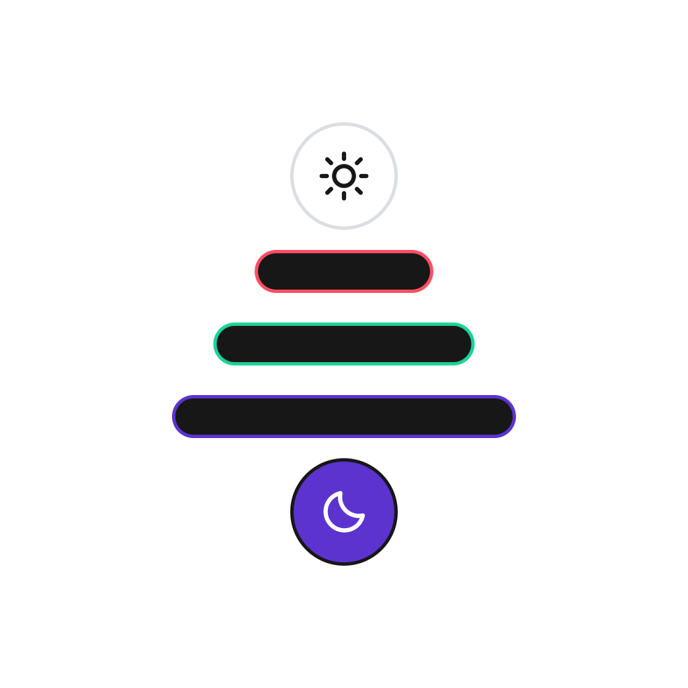

# Dievas design system

<p align="center"> 
</p>

Use this README to explore the workspace and run the gallery. For application setup and a first widget, see the [Flutter package guide](packages/dievas/README.md).

[Website](https://dievas.serticode.com) · [Component gallery](https://master.dievas-gallery.pages.dev) · [Flutter package](https://pub.dev/packages/dievas) · [Design tokens](https://pub.dev/packages/dievas_tokens)

## Start here

Choose the guide for your task:

- [Use Dievas in a Flutter app](packages/dievas/README.md)
- [Use pure Dart design tokens](packages/dievas_tokens/README.md)
- [Run the workspace and gallery](#run-locally)
- [Use the logo and brand assets](branding/README.md)
- [Read component changes](packages/dievas/CHANGELOG.md)

## What Dievas includes

Dievas is a Melos monorepo that houses a token layer, a full theme architecture, a Flutter component library, and a live gallery app.

It is **not an application**. It is the foundation that applications build on.

The three layer model that drives it:

```text
Moon Design System      →   component catalogue and visual reference  (what we port)
Dievas Design Pattern  →   architectural blueprint                   (how we structure it)
Dievas                  →   the output                                (our system, our API)
```

## Workspace structure

```text
dievas/
├── packages/
│   ├── dievas_tokens/      # Pure Dart — primitive + semantic token layer
│   ├── dievas/             # Flutter — theme stack + component library
│   └── dievas_gallery/     # Flutter app — live component showcase (Widgetbook)
├── branding/               # SVG logo masters and identity guidelines
├── landing/               # Jaspr static + Tailwind v4 landing page
├── pubspec.yaml            # Melos workspace root
└── analysis_options.yaml   # Shared lint rules (line length: 120)
```

### Package dependency rule

```text
dievas_gallery  →  dievas  →  dievas_tokens (pure Dart, zero Flutter dependency)
```

`dievas_tokens` must never import Flutter. It is safe to use in Dart only targets like CLI tools, Jaspr, server side code.

A Flutter import in that package is a bug.

## Token architecture

### Two tier model

**Primitives** — raw values with no semantic meaning. Raw `int` or `double` constants, no Flutter types.

```dart
abstract final class DievasColourPrimitives {
  static const int royalPurple = 0xFF5C33CF;
  static const int black = 0xFF000000;
}
```

**Semantic tokens** — pure Dart aliases that map primitives to roles. No Flutter types live in `dievas_tokens`; `Color`, `TextStyle`, and `BoxShadow` wrapping happens in the `dievas` Flutter package.

```dart
// dievas_tokens — pure Dart, no Flutter import
abstract final class DievasColourSemanticLight {
  static const int textPrimary = DievasColourPrimitives.black;
  static const int buttonPrimaryBackground = DievasColourPrimitives.royalPurple;
}

// dievas package — Color wrapping happens here
static const Color textPrimary = Color(DievasColourSemanticLight.textPrimary);
```

Colour roles use **grouped semantic naming** — `textPrimary`, `bgBase`, `actionPrimary`, `borderDefault` — not Moon character names. Primitive scales follow the Tailwind convention: `50` → `950`.

### Size-token naming law

Every **size-axis** token uses `<base><SIZE>` — a lowercase base followed by an **UPPERCASE** size suffix: `XS`, `SM`, `MD`, `LG`, `XL`, `XL2`…`XL8`, with half-steps `SMPlus`, `MDPlus`, `LGPlus`, `XLPlus`. Examples: `spacingMD`, `radiusLG`, `fontSizeXL`, `sizeXL2`, `breakpointSM`. The suffix always trails the base. Non-size axes — opacity, z-index, easing, animation intents, `touchMin` — stay camelCase.

The size scale obeys the **4pt / 8pt grid law**: 4pt is the grid, 8pt is preferred, and half-steps are allowed only where optical weight or platform touch targets require them (and must carry a doc comment).

### Token families

| Family     | Primitives file              | Semantic file                     |
| ---------- | ---------------------------- | --------------------------------- |
| Colour     | `colour_primitives.dart`     | `colour_semantic_light/dark.dart` |
| Typography | `typography_primitives.dart` | `typography_semantic.dart`        |
| Spacing    | `spacing_primitives.dart`    | `spacing_semantic.dart`           |
| Sizing     | `sizing_primitives.dart`     | `sizing_semantic.dart`            |
| Radius     | `radius_primitives.dart`     | `radius_semantic.dart`            |
| Elevation  | `elevation_primitives.dart`  | `elevation_semantic.dart`         |
| Opacity    | `opacity_primitives.dart`    | `opacity_semantic.dart`           |
| Duration   | `duration_primitives.dart`   | —                                 |
| Animation  | `duration_primitives.dart`   | `animation_semantic.dart`         |
| Breakpoint | `breakpoint_primitives.dart` | `breakpoint_semantic.dart`        |
| Easing     | `easing_primitives.dart`     | `easing_semantic.dart`            |
| Z-Index    | —                            | `z_index_semantic.dart`           |

Typography uses **MartianMono** (body, label, title, display, heading) with **Cascadia Code** for inline code and code blocks.

## Theme architecture

### Inheritance chain

```text
DievasThemeData               ← abstract interface (the contract)
  └── DievasGlobalThemeData   ← base class (shared construction logic)
       ├── DievasLightThemeData   ← default brand, light
       ├── DievasDarkThemeData    ← default brand, dark
       └── [AppThemeData]         ← consumer app's brand (lives in the app, not here)
```

`DievasTheme` is an `InheritedModel<DievasThemeAspect>`. Each sub system (`colours`, `typography`, `spacing`, `sizing`, `border`, `elevation`, `opacity`, `animation`, `components`, `material`) is a named aspect; a widget that depends only on `colours` does not rebuild when `spacing` changes.

### Context extension — flat API

```dart
// Inside any widget's build method
final color = context.colours.action.actionPrimary;
final style = context.typography.labelMD;
final gap   = context.spacing.MD;
final cols  = context.grid.columns;   // inside a DievasGrid
```

### Brand palettes

Custom brand colours resolve from a selectable `DievasBrandPalette` — one full 11 tint colour family ramp plus an `onBrand` contrast colour. `DievasBrandPalettes` ships eleven optional palettes: `indigo` plus ten alternatives (`sky`, `green`, `violet`, `red`, `amber`, `ocean`, `forest`, `berry`, `dusk`, `terracotta`). Roles resolve by brightness (`rolesForLight` / `rolesForDark`), while the built in themes use Moon Design’s Piccolo purple (`#5C33CF`) in both light and dark mode.

### Create a brand theme

Use `DievasLightThemeData` and `DievasDarkThemeData` for the default brand. To create a custom brand, extend `DievasGlobalThemeData` with your own brand tokens — either by selecting a shipped palette or by supplying a full `DievasColourThemeData`:

```dart
// In an Example app — not in this repo
final class ExampleLightThemeData extends DievasGlobalThemeData {
  ExampleLightThemeData({super.components})
    : super(
        brandPalette: DievasBrandPalettes.violet,
        colours: DievasLightThemeData().colours,
      );
}
```

Create the corresponding dark theme with `DievasDarkThemeData().colours`, then provide both themes at the app root. The following fragment assumes `ExampleDarkThemeData` is defined:

```dart
DievasScope(
  lightTheme: ExampleLightThemeData(),
  darkTheme: ExampleDarkThemeData(),
  child: MaterialApp.router(...),
)
```

The design system never knows which brand is running. Brand is resolved at `DievasScope` instantiation.

## Component anatomy

Buttons demonstrate the widget, builder, type, and theme layers used to structure components:

```text
Widget side                          Theme side
───────────────────────────────────  ─────────────────────────────────────────
dievas_filled_button.dart            dievas_filled_button_theme_data.dart
dievas_outlined_button.dart          dievas_outlined_button_theme_data.dart
dievas_button.dart  (@internal)      dievas_button_theme_data.dart
dievas_button_builder.dart           dievas_button_theme_style.dart  (@internal)
types/                               dievas_button_theme_state_style.dart
  dievas_button_size.dart (enum)     dievas_button_theme_value.dart  (typedef)
  dievas_button_state.dart (enum)
  dievas_button_style.dart (sealed)
```

Rules components always follow:

- No hardcoded colour, size, or spacing value — everything comes from `context.*`
- No `ThemeData` parameters on the widget itself — components read from `DievasTheme.componentsOf(context)`
- The `style` field is always a sealed class or enum, never a raw string

## Components

37 components shipped across nine groups:

| Group                | Count | Components                                                                                                                                                            |
| -------------------- | ----- | --------------------------------------------------------------------------------------------------------------------------------------------------------------------- |
| **Buttons**          | 4     | `DievasFilledButton`, `DievasOutlinedButton`, `DievasTextButton`, `DievasIconButton`                                                                                  |
| **Display**          | 9     | `DievasAvatar`, `DievasBadge`, `DievasCircularProgress`, `DievasDivider`, `DievasDotIndicator`, `DievasEmptyState`, `DievasIcon`, `DievasLinearProgress`, `DievasTag` |
| **Form**             | 8     | `DievasAuthCode`, `DievasCheckbox`, `DievasRadio`, `DievasSegmentedControl`, `DievasSwitch`, `DievasTextArea`, `DievasTextInput`, `DievasTextInputGroup`              |
| **Feedback**         | 3     | `DievasAlert`, `DievasBanner`, `DievasSnackbar`                                                                                                                       |
| **Menu**             | 2     | `DievasDropdown`, `DievasMenuItem`                                                                                                                                    |
| **Overlays**         | 3     | `DievasBottomSheet`, `DievasModal`, `DievasTooltip`                                                                                                                   |
| **Search**           | 2     | `DievasSearchWithList`, `DievasSearchWithDropdown`                                                                                                                    |
| **Nav / Disclosure** | 5     | `DievasAccordion`, `DievasBreadcrumb`, `DievasDrawer`, `DievasPopover`, `DievasTabBar`                                                                                |
| **Utility**          | 1     | `DievasLoader`                                                                                                                                                        |

## Grid system

`DievasGrid` gives any widget breakpoint aware layout via `LayoutBuilder`.

| Breakpoint | Min width | Columns | Margin | Gutter |
| ---------- | --------- | ------- | ------ | ------ |
| `XS`       | 0px       | 4       | 16     | 16     |
| `SM`       | 360px     | 4       | 16     | 16     |
| `MD`       | 700px     | 8       | 32     | 24     |
| `LG`       | 1000px    | 12      | 32     | 24     |
| `XL`       | 1348px    | 12      | 32     | 24     |

## Run locally

Use a Flutter SDK that includes Dart `>=3.11.4 <4.0.0`. Melos is declared in the root `pubspec.yaml`.

From the repository root, resolve dependencies and bootstrap the workspace:

```bash
flutter pub get
dart run melos bootstrap
```

Run workspace checks from the repository root:

```bash
dart run melos run analyze          # dart analyze across all packages
dart run melos run format           # dart format (line length: 120)
dart run melos run test             # flutter test across test packages
dart run melos run codegen          # build_runner build
```

To run the gallery:

```bash
cd packages/dievas_gallery
flutter run -d chrome
```

Confirm that Widgetbook loads and that you can select a component. The landing page has separate Dart and Node.js dependencies; its setup and build commands are declared under `landing:*` in the root [workspace configuration](pubspec.yaml).

## Dart and Flutter versions

```text
Dart: >=3.11.4 <4.0.0
Flutter package constraint: >=3.22.0
```

The Dart constraint also applies when choosing a Flutter SDK; the Flutter lower bound alone is insufficient.

Dart 3 idioms throughout: pattern matching with `switch` expressions, sealed classes, records, exhaustive matching.

No legacy pre null safety patterns.

## Reference systems

| Reference                                     | Role in Dievas                       |
| --------------------------------------------- | ------------------------------------ |
| [Moon Design System](https://flutter.moon.io) | Component catalogue, visual language |

The landing page uses Jaspr static generation and Tailwind v4.

Token bridge: `landing/tool/generate_theme.dart` reads `dievas_tokens` constants and emits Tailwind `@theme {}` CSS; the same token values power both the Flutter widgets and the server rendered landing page.

## Team

Built by [Engineering](mailto:engineering@serticode.com) · Serticode Inc.
